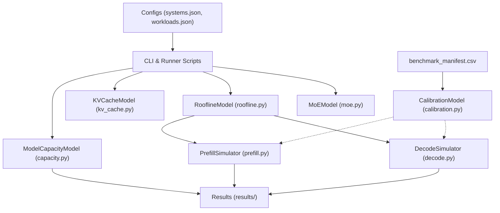

# Architecture Overview

## Objective
The `accelerator-sim` framework is designed for hardware exploration, architectural projection, and workload sizing for modern deep learning accelerators (specifically focusing on **A48** and **A216** design points).

## Component Architecture

## Module Breakdown

1. **Roofline Model (`roofline.py`)**:
   Provides operational intensity boundaries, ridge-point calculation, and ceilings for compute-bound vs memory-bandwidth-bound regimes.

2. **KV Cache Modeling (`kv_cache.py`)**:
   Accurately tracks memory consumption per token and per sequence, accounting for Grouped-Query Attention (GQA), Multi-Query Attention (MQA), precision scaling (FP16/FP8/FP4), and PagedAttention fragmentation.

3. **Memory Capacity (`capacity.py`)**:
   Evaluates full device allocation: model weights, KV cache at target concurrency, activation buffers, and runtime context. Determines multi-device partition feasibility.

4. **Prefill Simulation (`prefill.py`)**:
   Calculates Time to First Token (TTFT) and prompt token throughput based on GEMM FLOPs, attention scaling, and memory traffic.

5. **Decode Simulation (`decode.py`)**:
   Simulates autoregressive token generation (TPOT / ITL), modeling memory bandwidth saturation during weight streaming and KV cache retrieval.

6. **Mixture-of-Experts Modeling (`moe.py`)**:
   Accounts for sparse routing, token dispatch, load imbalance factors across experts, and All-to-All collective latency over interconnect links.

7. **Empirical Calibration (`calibration.py`)**:
   Computes MAPE and fits hardware efficiency constants against ground-truth benchmark runs.
